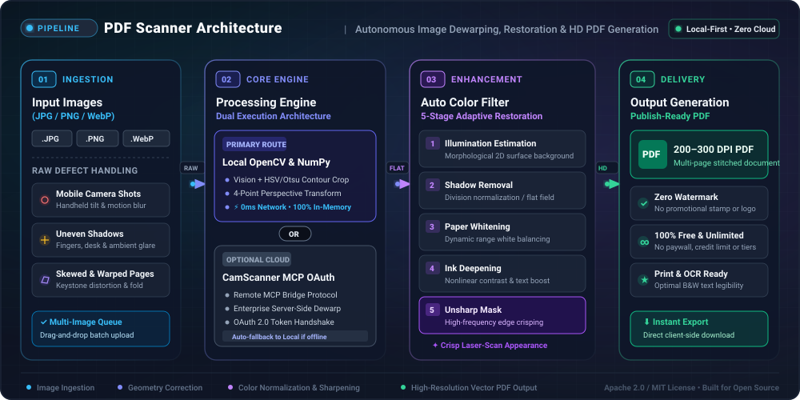

# PDF Scanner — macOS Studio & HD Document Engine 📄✨

[](LICENSE)
[](https://www.python.org/downloads/)
[](#)
[](#)
[-cyan.svg)](#)

<p align="center">
  
</p>

> **A local-first document scanner for macOS and Python CLI, with optional remote MCP workflow integration.**  
> Run the **100% Free, Offline Local Engine** (macOS Vision + OpenCV + Python) with zero watermarks and no artificial page limits, or optionally connect an external **CamScanner MCP** endpoint in AI agent clients. *(Not affiliated with or endorsed by CamScanner.)*

---

## ⚡ Key Highlights & Features

<p align="center">
  
</p>

- 🚀 **Zero Watermark:** Exports clean multi-page PDFs without promotional stamps or overlays.
- 🎨 **Auto Color Algorithm + White Balance + Stroke Compensation:** Neutralizes warm/cool/tinted paper casts via inner low-saturation paper white balance (`_estimate_global_wb_gain`, `[0.70, 1.45]`), estimates uneven illumination at bounded `<= 720 px` resolution with dark-block tapering (`_compute_background_ratio`), repairs `1–4 px` table breaks using real local stroke darkness (`compensate_strokes_and_lines` + adaptive ink threshold), applies `_MAGIC_LUT`, and sharpens edges with `_SHARPEN_KERNEL`.
- 📐 **Hybrid Vision + OpenCV Perspective & 128-Point Edge Cleaning:** Combines macOS Vision `VNDetectDocumentSegmentationRequest` with OpenCV HSV+Otsu + Canny white-on-white edge fallback (`detect_and_crop_with_info`, centroid polar corner ordering, solidity guard, relative size minimum) and 128-point curved-border cleaning (`multipoint_border_mask_clean`).
- 🧭 **Deskew + Quality-Gated 2D Surface Flattening & Optional Symmetry:** Automatically estimates global tilt (`0.3°–8.0°`), fits a regularized 2D surface (`max_shift = 1.8% min(h, w)`) and skips `cv2.remap` whenever line-straightness RMS fails to improve (`>= 15%` gain) or vertical coverage is sparse. Symmetric 4-side margin centering (`balance_page_symmetry`) is **off by default** (`--symmetry` to enable) so document layout stays anchored unless explicitly centered.
- 📦 **Multi-Format & Multi-Page Batch Compiler:** Ingests JPG, PNG, WebP, BMP, TIFF (including multi-page TIFF in CLI), HEIC/HEIF, and scanned PDFs in natural page order and compiles them into exact `A4`, `Letter`, or `Fit` PDFs (`pypdf` `/DCTDecode` in CLI, `CGPDFContext` in the macOS app).
- 🔒 **100% Offline Local Engine (Optional Cloud MCP):** The local CLI and macOS app never upload documents to the cloud. If you manually configure the remote CamScanner MCP server (`https://ai-tools.camscanner.com/mcp`) in an AI assistant, documents sent via MCP are processed on that third-party cloud service.

---

## 🔄 Image Processing Pipeline

<p align="center">
  
</p>

For full mathematical derivations and exact implementation parameters, see [docs/ALGORITHM_DEEP_DIVE.md](docs/ALGORITHM_DEEP_DIVE.md).

---

## 🏗️ Architecture & Orchestration

<p align="center">
  
</p>

---

## 🚀 Quick Start Guide

### 1. Prerequisites & Installation

**Python CLI (`scripts/batch_scanner.py`):**
- Python `3.10+`
- Dependencies pinned in [requirements.txt](requirements.txt) (including `pillow-heif` for `.heic`/`.heif` images)

```bash
# Clone the repository
git clone https://github.com/tienle20801/PDF-Scanner.git
cd PDF-Scanner

# Create a virtual environment and install Python dependencies
python3 -m venv .venv
source .venv/bin/activate
pip install -r requirements.txt
```

**macOS Desktop App (`PDF Scanner.app`) requirements:**
- macOS `14.0+` (Apple Silicon `arm64`)
- **Prebuilt `.app` / `.dmg`:** Runs standalone out-of-the-box (bundles relocatable Python 3.10 + OpenCV dependencies and precompiled `bin/doc_scanner`)
- **Running from source (`./macos_app/build_app.sh`):** Xcode Command Line Tools (`xcode-select --install`) and `.venv` with [requirements.txt](requirements.txt) installed (for `Hybrid OpenCV + Vision` bundling)

### 2. Batch Scan Mobile Photos or Scanned PDFs into One HD PDF

Place your raw photos (`.jpg`, `.png`, `.webp`, `.bmp`, `.tif`/`.tiff`, `.heic`) or scanned `.pdf` files in a folder, then run:

```bash
./scan.sh "path/to/raw_photos" "output/Scanned_Document_HD.pdf" --mode auto_color --dpi 200
```

Available CLI options (`python scripts/batch_scanner.py --help`):
- `--output <path.pdf>` (explicit output PDF path, overrides positional `output_pdf`)
- `--mode auto_color|clean|bw|grayscale|original` (default: `auto_color`; `magic_color` is accepted as a backward-compatible alias)
- `--crop-engine auto|vision|opencv` (default: `auto` — uses macOS Vision `doc_scanner.swift` when available, otherwise OpenCV HSV+Otsu contour detection)
- `--min-confidence <0.0..1.0>` (default: `0.45`, Vision crop confidence threshold)
- `--multipoint-points <int>` (default: `32` = `128` edge control points; `0` to disable)
- `--page-size a4|letter|fit` (default: `a4`), `--dpi <int>` (default: `200`, downscales large pages only; `>= 72`), `--margin <pts>` (default: `20.0`), `--jpeg-quality <1..100>` (default: `86`)
- `--workers <int|auto>` (default: `1`, page-level streaming; `'auto'`/`0` selects `1` for small/low-res batches or up to `4` processes for larger high-res batches; `>1` forces multiprocessing), `--no-crop`, `--no-flatten`, `--symmetry` / `--no-symmetry` (symmetry off by default), `--worker-stdio`, `--emit-dir <dir>`, `--manifest <file.json>`, `--save-debug <dir>`

Independent vector-preserving PDF compression CLI ([scripts/pdf_compressor.py](scripts/pdf_compressor.py)):
```bash
.venv/bin/python scripts/pdf_compressor.py input.pdf output_compressed.pdf --dpi 150 --target-mb 10.0 --mode original
```
This keeps pure vector/text pages and original page `MediaBox` sizes untouched while re-encoding embedded raster XObjects via a binary-search quality/DPI loop until reaching the target size budget (or reporting the tightest readable limit).

Color and `grayscale` pages are JPEG-encoded once at the end (`quality=86` default in Python CLI, `88` in `doc_scanner.swift`) and embedded as `/DCTDecode` (`/DeviceRGB` or `/DeviceGray`); `bw` pages in Python CLI are stored as 1-bit PNGs and embedded as 1-bit `/FlateDecode` (`/DeviceGray`) inside exact `A4`, `Letter`, or `Fit` `MediaBox` PDFs.

*Streaming & Worker execution:* `convert_folder_to_hd_pdf` processes pages in streaming mode (`workers=1`) or isolated per-page subprocesses (`--workers auto|<N>`), keeping isolated 10-page 12MP CLI Peak RSS at `434.5 MiB` (`2.65 s`, `0.27 s/page` at `--workers 1`; `--workers auto` avoids multiprocessing spawn overhead on small `<= 8`-page or `< 1.5 MP` batches). Live UI previews reuse a single warm `--worker-stdio` Python process to avoid repeated OpenCV import latency.

### 3. macOS Native Desktop App (`PDF Scanner.app`)

To build a self-contained `PDF Scanner.app` (`arm64` macOS 14.0+, bundling relocatable Python 3.10 + OpenCV dependencies and precompiled `bin/doc_scanner`) and optional `PDF-Scanner.dmg`:

```bash
./macos_app/build_app.sh
./macos_app/build_dmg.sh
open "PDF Scanner.app"
```

Key UI capabilities:
- **Drop-First Contextual Studio & Finder Open With:** Supports drag-and-drop, Dock icon drops, and Finder **Open With**, adapting cleanly across `Scan`, `Ghép 2 mặt` (Pair Front + Back), `Tách PDF` (Split), `Gộp / Xoay` (Merge & Rotate), and `Nén nhẹ` (vector-preserving PDF compression with target-size loop `≤ 10 MB / 5 MB / 2 MB` and `Original` mode default).
- **Auto Reading Orientation & Optional Invisible OCR (`vi-VT` + `en-US`):** Sorts multi-file drops naturally (`1, 2, 3... 10`), detects text reading orientation via single-pass `.accurate` baseline corner voting (`0° / 90° / 180° / 270°`), and optionally embeds a searchable/selectable invisible CoreText PDF text layer (`enableOCR`, off by default for maximum speed) sharing OCR observations when upright.
- **Interactive Before ↔ After Split Slider & Startup Preflight:** Drag the split curtain directly across `Original` ↔ `Scanned` with Pinch-to-Zoom and slider zoom (`50%`–`400%`), inspect PDFs with `PDFKit`, and run an automatic Python/OpenCV + Vision preflight check on startup with one-click fallback to `Pure Swift Vision`.
- **Honest Engine Modes & Batch Naming Rules:** Switch between `Hybrid OpenCV + Vision` and `Pure Swift Vision` (`Clean`, `Grayscale`, `B&W`, `Original` natively in CoreImage/Vision, hiding Hybrid-only geometry options when `Pure Swift Vision` is active), reuse cached pages on export, and apply safe pattern naming (`TaiLieu_xx`, `Ngay_xx.11`).

---

## 📈 Measured Benchmark (Apple Silicon)

Measured reproducibly with [scripts/benchmark.py](scripts/benchmark.py) on synthetic 12MP (`4032×3024`) documents:

- **Hardware & Software:** Apple M1 (`arm64`, 8 cores, 8 GB RAM), `Darwin 27.2.0`, Python `3.10.22`, OpenCV `5.0.0`, NumPy `2.2.6` (measured LoadAvg `8.53–9.61`, Peak RSS isolated via `/usr/bin/time -l`)
- **Command:** `.venv/bin/python scripts/benchmark.py --pages 10 --runs 5 --workers 1`

| Benchmark Workload | Median / Min Result | Notes |
|---|---:|---|
| **Single 12MP Page — 6-Stage Pipeline (`A4 @ 200 DPI`, OpenCV)** | **`264.1 ms` / `215.7 ms`** | `detect_and_crop` 27.5 / 16.9 ms, `downscale` 25.0 / 19.7 ms, `multipoint` 25.0 / 14.1 ms, `enhance` 53.8 / 45.0 ms, `flatten` 68.1 / 66.0 ms, `symmetry` 42.3 / 39.3 ms |
| **Single 12MP Page — `enhance_image_bgr` on full 12MP** | **`185.2 ms` / `149.7 ms`** | Strided paper WB/scalars + SIMD `cv2.multiply` scaling & OpenCV stroke masking |
| **10-Page 12MP Batch (`workers=1`, `A4 @ 200 DPI`, OpenCV)** | **`2.65 s` (`0.27 s/page`)** | Output PDF: `1.39 MiB` • Isolated CLI Peak RSS: **`434.5 MiB`** |
| **10-Page 12MP Batch (`workers=auto`, `A4 @ 200 DPI`, OpenCV)** | **`3.70 s` (`0.37 s/page`)** | Uses 4 spawned workers (`>= 9` 12MP pages); `workers=4` explicit: `4.59 s`, parent RSS `371.9 MiB` |

---

## 🤖 Optional Remote MCP Setup (Cloud)

> ⚠️ **Privacy notice:** Local CLI and `PDF Scanner.app` processing are 100% offline. Configuring the remote CamScanner MCP server below sends documents from your AI client to `https://ai-tools.camscanner.com/mcp` (a third-party cloud service).

### Kilo CLI (`kilo.json` or `kilo.jsonc`)
```jsonc
{
  "mcp": {
    "camscanner-mcp": {
      "type": "remote",
      "url": "https://ai-tools.camscanner.com/mcp",
      "headers": {
        "X-IS-AGENT": "general"
      },
      "enabled": true
    }
  }
}
```

### Claude Desktop (`claude_desktop_config.json`)
```json
{
  "mcpServers": {
    "camscanner": {
      "url": "https://ai-tools.camscanner.com/mcp",
      "headers": {
        "X-IS-AGENT": "general"
      }
    }
  }
}
```

👉 **MCP Setup Notes:** [docs/MCP_INTEGRATION_GUIDE.md](docs/MCP_INTEGRATION_GUIDE.md) *(verify current endpoints/headers against official CamScanner MCP docs before production use).*

---

## 🧪 Running Tests

```bash
# Run full 23-case Python (unittest) & Swift (PDFToolsService, ScannerBridge, OCR, B5, A1/A2, P0/P1/P2, speed regressions) suite
./tests/run_all.sh
```

---

## ⚠️ System Requirements, Known Limits & Troubleshooting

- **Standalone macOS App (`PDF Scanner.app`):** Requires macOS 14.0+ on Apple Silicon (`arm64`) when built with `build_app.sh` (bundles standalone `python_runtime` + `site-packages` + precompiled `bin/doc_scanner`, ~`206 MiB`).
- **Source CLI Mode:** Requires Python 3.10+ with `requirements.txt` (`opencv-python`, `pillow`, `pillow-heif`, `numpy`, `pypdf`). On macOS with Command Line Tools or Xcode, Apple Vision crop is enabled automatically.
- **Troubleshooting:**
  - *Missing `cv2` / Python dependency alert in app:* Run `uv pip install -r requirements.txt` (or build `.app` via `./macos_app/build_app.sh`), or click **Use Pure Swift Vision** in the startup banner to run dependency-free via macOS Vision + CoreImage.
  - *Python CLI skips a PDF page (`vector/text without embedded raster images`):* `scripts/batch_scanner.py` only extracts raster images from PDF pages. Use `PDF Scanner.app` (renders via `PDFKit` at 260 DPI) or pre-rasterize vector PDFs before CLI processing.
- **Known Limits:** Zero-contrast white-on-white capture without shadows/desk edges, severe glossy specular reflections, deep 3D book-spine curvature beyond the 1.8% displacement clamp, and heavily textured tablecloths remain challenging without manual corner framing.

---

## 📄 License & Dependencies

This project is licensed under the [MIT License](LICENSE). Bundled/required third-party components:
- `OpenCV` (Apache-2.0), `NumPy` (BSD-3-Clause), `Pillow` (HPND), `pillow-heif` (LGPL/Apache-2.0), `pypdf` (BSD-3-Clause), and macOS system frameworks (`AppKit`, `CoreImage`, `CoreText`, `PDFKit`, `Vision`).

---

<p align="center">
  Crafted with ❤️ for students, researchers, developers, and AI agents worldwide.
</p>
